# 🚜 Ficha de Refacción: Arquitectura de IA Híbrida (Tractor Local vs. Jet Cloud)

## 🔴 1. La Pesadilla Operativa Previa (Baseline 1X — El Dilema B2B)

* **El Muro de la Privacidad Corporativa (Paranoia Justificada):** En ventas B2B a clientes de peso (contratistas de obra pública, licitaciones de defensa, sector salud, refinerías, banca), el cliente impone cláusulas de confidencialidad estrictas (NDAs). Exigen que sus secretos de costos, márgenes de utilidad y pliegos confidenciales **no viajen por internet** a servidores públicos de terceros en EE.UU.
* **El Pánico a la Facturación por Consumo (OPEX Descontrolado):** Si una empresa debe procesar 500 pliegos o contratos de 200 páginas por noche, el modelo SaaS tradicional basado en consumo de tokens en la nube puede generar facturas imprevistas de miles de dólares mensuales.
* **La Trampa del "FOMO Tecnológico" en el Desarrollador:** Muchos fundadores y programadores intentan forzar la instalación de modelos gigantescos en sus propias computadoras portátiles por simple moda técnica. Esto satura la memoria RAM del equipo de desarrollo, ralentiza el trabajo y desvía la energía del verdadero objetivo: **vender y resolver el dolor del cliente**.

---

## 🟢 2. La Transformación Operativa (El Paradigma Jet vs. Tractor)

La arquitectura moderna de inteligencia artificial debe dividirse con claridad industrial entre la fase de **Diseño/Desarrollo** y la fase de **Operación del Cliente**:

```mermaid
flowchart TD
    subgraph TALLER_DEV ["1. Taller de Desarrollo (Nuestra Empresa)"]
        Founder["Director / Estratega Humano"]
        SDD["Metodología SDD (Contratos & Cirugía)"]
        Jet["El Jet Supersónico: Nube Gemini 3.8 / Pro\n- Velocidad: 1 segundo\n- Máxima inteligencia cognitiva\n- Cero gestión de servidores"]
        Founder --> SDD --> Jet
    end

    subgraph CLIENTE_ENTERPRISE ["2. Instalación en el Cliente (On-Premise / Edge)"]
        ServidorCliente["Servidor Físico / Estación del Cliente (Tractor Diésel)"]
        AntigravitySDK["Google Antigravity SDK + LiteRT / Gemma / Ollama"]
        LocalModel["Procesamiento 100% Offline\n- 500 pliegos/noche a costo $0\n- Datos nunca salen del cable de red local"]
        ServidorCliente --> AntigravitySDK --> LocalModel
    end

    subgraph HIBRIDO ["3. El Patrón Híbrido (Orquestador Óptimo)"]
        CloudBoss["Jefe en la Nube (Gasta 95 tokens)\nDefine la estrategia y el plan"]
        LocalWorker["Obrero Local en GPU (Gasta 3.500+ tokens)\nAudita, extrae y procesa masivamente a costo $0"]
        CloudBoss -.->|"Plan Ligero"| LocalWorker
    end
```



### La Analogía Industrial:
1. **El Jet Supersónico de la Nube (Gemini en Google Cloud):**
   * *Función:* Es el despacho de ingenieros de élite. Se usa en nuestro taller de programación para pensar arquitectura, resolver problemas complejos y escribir código con Spec-Driven Development (SDD).
   * *Ventaja:* Vuela a la velocidad de la luz, no ensucia la casa y responde al instante.
2. **El Tractor Diésel de la Máquina Local (On-Premise con Antigravity SDK / LiteRT / Gemma):**
   * *Función:* Es la maquinaria pesada dentro de las instalaciones del cliente.
   * *Ventaja:* No va a la velocidad de un jet (tarda 10 segundos en vez de 1 segundo), pero ara la tierra que le pongan, funciona bajo lluvia torrencial sin internet, no le cobra sueldo a nadie por hectárea arada (costo de tokens = \$0) y el grano cosechado nunca sale de los linderos de la finca del cliente.

---

## 💣 3. Secretos Sucios de Producción & Tácticas Comerciales del Gemba

* 💰 **El Salto Comercial (De Suscripción de \$50 a Contrato de \$15.000 USD):**  
  En lugar de cobrarle a una empresa una suscripción pequeña donde tú asumes el riesgo del costo de los tokens, le vendes una solución **Enterprise On-Premise**:
  1. El cliente compra el hardware como activo fijo de su empresa (CAPEX depreciable).
  2. Le cobras entre \$5.000 y \$15.000 USD por la licencia e instalación llave en mano de su *"Búnker de Inteligencia Privada"*.
  3. Le cobras una **Póliza Anual de Mantenimiento y Soporte (SLA)** del 20% anual.
* 🛡️ **El Secreto del Abogado con Lentes (Mito de la Desactualización):**  
  Los clientes temen que los modelos locales queden "obsoletos" cuando cambia una ley. La realidad industrial: **el modelo no necesita saber la ley de memoria**. El modelo es como un abogado con lentes: tú le entregas el PDF de la nueva circular o el pliego licitatorio del día de hoy (RAG in-situ), y el modelo lo analiza con precisión quirúrgica porque su capacidad de razonamiento y lectura no se vence.
* 🔧 **La Oportunidad del Cambio de Aceite y Filtro:**  
  La necesidad de actualizar los pesos de los modelos locales periódicamente no es un problema técnico; es la justificación comercial perfecta para cobrar el soporte técnico recurrente anual.
* 🎯 **La Paradoja de los Tokens Sobrantes:**  
  Que a un fundador le sobren tokens en su plan de IA no significa que trabaje lento; significa que trabaja como un **cirujano con SDD**. El desperdicio masivo de tokens solo ocurre cuando se improvisa a ciegas (*Vibe Coding*). Cuando hay contrato formal y claridad arquitectónica, se hacen tiros certeros y eficientes.

---

## 💻 4. Solución de Software & Lego Blocks

### A. Configuración Canónica de Agente Local / Híbrido con Antigravity SDK
```python
"""
Orquestador Local Autónomo basado en Google Antigravity SDK + LiteRT
Ejecuta auditoría y extracción masiva de documentos en hardware local a costo $0.
"""
import asyncio
import os
from google.antigravity import Agent, LiteRTAgentConfig, LocalOpenAIAgentConfig
from google.antigravity.hooks import policy

# Ruta al modelo descargado localmente (Gemma 4 / LiteRT-LM)
LOCAL_MODEL_PATH = os.path.expanduser("~/.litert-lm/models/gemma4-26b/model.litertlm")
WORKSPACE_DIR = os.path.expanduser("~/bunker-workspace")

async def run_local_task(prompt: str):
    os.makedirs(WORKSPACE_DIR, exist_ok=True)
    
    # Configuración de agente local optimizado para inferencia en GPU/CPU del cliente
    config = LiteRTAgentConfig(
        model_path=LOCAL_MODEL_PATH,
        workspaces=[WORKSPACE_DIR],
        policies=[policy.allow_all()]
    ).lightweight()
    
    print(f"[ON-PREMISE ENGINE] Iniciando inferencia 100% offline y soberana...")
    
    async with Agent(config) as agent:
        response = await agent.chat(prompt)
        async for token in response:
            print(token, end="", flush=True)

# Alternativa Universal para servidores con Ollama o vLLM:
def get_universal_local_config(model_name: str = "qwen2.5-coder"):
    return LocalOpenAIAgentConfig(
        base_url="http://localhost:11434/v1",
        api_key="ollama",
        model=model_name
    )

if __name__ == "__main__":
    prompt_licitacion = (
        "Analiza el archivo 'pliego_condiciones.pdf' en el workspace. "
        "Extrae: 1. Códigos UNSPSC exigidos. 2. Índices de liquidez y endeudamiento requeridos. "
        "3. Fecha y hora límite para presentar observaciones. Genera el reporte en formato JSON."
    )
    asyncio.run(run_local_task(prompt_licitacion))
```

### B. Matriz de Decisión Estratégica (Brújula para el Negocio)

| Criterio | Modo Jet (Cloud SaaS) | Modo Tractor (On-Premise / Local) | Modo Híbrido (Orquestado) |
| :--- | :--- | :--- | :--- |
| **Volumen de Documentos** | Bajo o medio (< 1.000 docs/mes) | Masivo (> 10.000 docs/mes) | Masivo con triaje estratégico |
| **Costo Marginal de Token** | Pagado por API (céntimos/consulta) | **\$0 (Cero costo de API)** | Céntimos en planeación, \$0 en ejecución |
| **Privacidad / Confidencialidad** | Datos viajan encriptados por internet | **100% Confinado en la oficina del cliente** | Título y metadatos en nube, contenido privado en local |
| **Infraestructura Requerida** | Cualquier laptop básica con internet | Servidor local o estación con GPU de trabajo | Servidor de oficina + conexión de control |
| **Modelo Comercial** | Suscripción mensual recurrente (\$50 - \$200/m) | **Venta de Licencia (\$5K - \$15K) + SLA Anual** | Licencia base + micro-bolsa de tokens de mando |

---

## 🔒 5. Checklist de Verificación para Implementación en Nuevos Clientes

1. [ ] **Auditoría de Requisitos del Cliente:** ¿El cliente exige legalmente que los datos no salgan de su red local? (Si es SÍ $\rightarrow$ activar Modo Tractor).
2. [ ] **Verificación de Hardware en Gemba:** Verificar que el servidor local del cliente cuente con GPU dedicada (Nvidia $\ge 12\text{ GB}$ VRAM o memoria unificada suficiente) y almacenamiento SSD.
3. [ ] **Mantenimiento de Contrato SDD:** Mantener la programación y diseño de nuevas funcionalidades en el entorno de desarrollo central bajo SDD; el cliente solo recibe el artefacto final empaquetado (*Appliance*).
4. [ ] **Acuerdo de Nivel de Servicio (SLA):** Incluir contractualmente la póliza de calibración periódica de modelos para garantizar ingresos recurrentes post-instalación.
