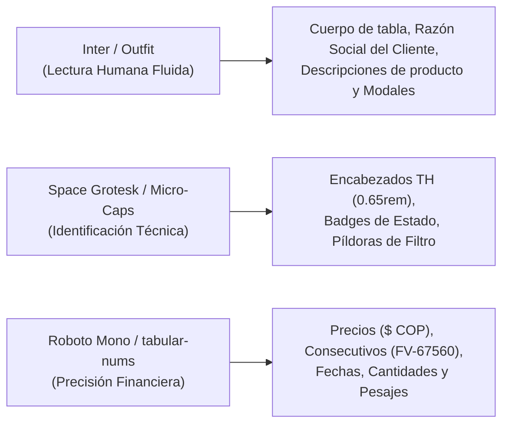
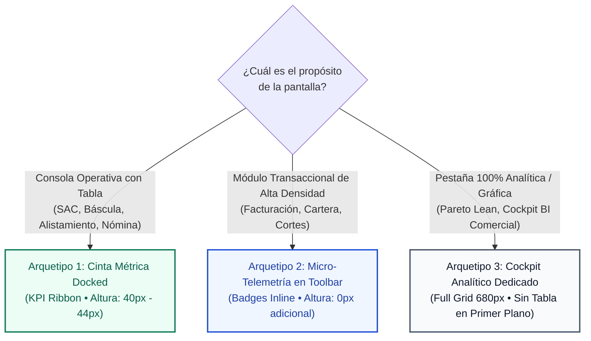
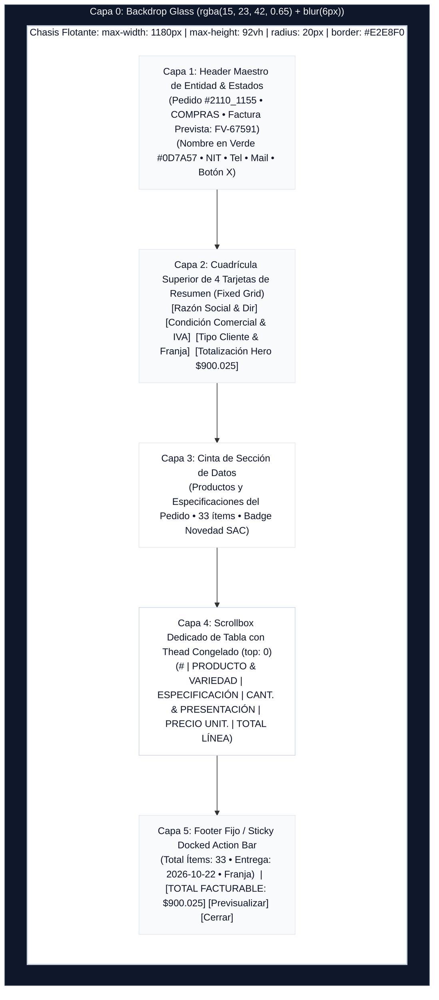

# Manual Canónico del Sistema de Diseño (Design System Manual)
## Ecosistema FruFresco & OnFRU Operational OS
**Versión:** 1.1.0 (Basado en el estándar *Swiss Precision Industrial UI - Skin 1*)  
**Ámbito de Aplicación:** Todos los módulos web, dashboards administrativos, consolas operativas de planta y componentes de cliente del ecosistema FruFresco.

---

## 1. Filosofía & Principios Rectores

El Sistema de Diseño de FruFresco surge de la necesidad física del **Gemba** agroindustrial: operadores de báscula, jefes de alistamiento, líderes de compras, conductores y directores comerciales pasan entre 8 y 10 horas diarias interactuando con estas pantallas en entornos de alta velocidad y estrés operativo.

### Los Tres Mandamientos del Diseño FruFresco:
1. **Máxima Densidad sin Asfixia Cognitiva:** Presentar la mayor cantidad de datos útiles por pulgada cuadrada sin que la pantalla se sienta atestada ni genere fatiga ocular.
2. **Ergonomía Clínica & Alto Rendimiento:** Fondos descansados (grises clínicos tierra), tipografía tabular para números y contraste semántico estricto (WCAG AAA).
3. **Cero "Vibe Coding" Visual:** Queda estrictamente prohibido improvisar clases de color, paddings aleatorios o sombras desmedidas. Cada elemento debe responder a los tokens oficiales definidos en este manual y en `src/lib/adminTheme.ts`.

---

## 2. Tokens de Color Oficiales (Paleta Semántica)

```
┌────────────────────────────────────────────────────────────────────────┐
│                        FONDOS Y ESTRUCTURA                             │
├──────────────────────┬──────────────────────┬──────────────────────────┤
│ Background Canvas    │ Surface (Tarjetas)   │ Surface Alt (Cebra/Doc)  │
│ #F4F7F6 / #F8FAFC    │ #FFFFFF              │ #F8FAFC / #F1F5F9        │
└──────────────────────┴──────────────────────┴──────────────────────────┘
┌────────────────────────────────────────────────────────────────────────┐
│                        BORDES Y CONTORNOS                              │
├──────────────────────┬──────────────────────┬──────────────────────────┤
│ Border Standard      │ Border Active / Dock │ Border Focus Primario    │
│ #E2E8F0 / #E5E7EB    │ #CBD5E1              │ #0D7A57                  │
└──────────────────────┴──────────────────────┴──────────────────────────┘
┌────────────────────────────────────────────────────────────────────────┐
│                        TEXTOS Y TIPOGRAFÍA                             │
├──────────────────────┬──────────────────────┬──────────────────────────┤
│ Text Main (Carbón)   │ Text Secondary       │ Text Muted (Metadatos)   │
│ #0F172A / #1A231E    │ #475569              │ #64748B / #94A3B8        │
└──────────────────────┴──────────────────────┴──────────────────────────┘
```

### Acentos de Marca & Micro-Badges Semánticos

| Rol de Negocio | Background | Borde | Texto / Icono | Uso Canónico |
| :--- | :--- | :--- | :--- | :--- |
| **Primario / Acción** | `#0D7A57` | `#0A5F43` | `#FFFFFF` | Botones de corte, enlaces activos, pestañas seleccionadas. |
| **Primario Hover** | `#0A5F43` | `#064E3B` | `#FFFFFF` | Interacción hover sobre acciones primarias. |
| **Verde Clínico / Éxito** | `#ECFDF5` | `#BBF7D0` | `#065F46` | Pedidos conformes, sin mermas, conciliaciones aprobadas. |
| **Garantía / Reposición $0** | `#ECFDF5` | `#A7F3D0` | `#047857` | Remisiones de garantía en $0 COP con subtexto de trazabilidad. |
| **Azul SAC / Novedad Resuelta**| `#EFF6FF` | `#BFDBFE` | `#1D4ED8` | Ajustes de factura resueltos por SAC, notas de crédito formalizadas. |
| **Ámbar Preventivo / Alerta** | `#FFFBEB` | `#FDE68A` | `#92400E` | Compras pendientes de cierre, pedidos en gracia, alertas de corte. |
| **Rojo Crítico / Pérdida** | `#FEF2F2` | `#FECACA` | `#DC2626` | Productos a pérdida (<0% margen), pedidos rechazados, mermas graves. |
| **Pastilla Inactiva / Neutra**| `#F1F5F9` | `#E2E8F0` | `#475569` | Filtros secundarios, pedidos en preparación, badges neutros. |

---

## 3. Triplete Tipográfico & Jerarquía Visual

Para erradicar la monotonía y organizar la información con precisión metrológica, se utiliza el **Triplete Tipográfico**:



### Escala Tipográfica Estándar:
* **Título de Módulo / Hero:** `1.15rem` - `1.30rem` | `font-weight: 900` | Carbón `#0F172A`.
* **Razón Social de Cliente en Tabla:** `0.78rem` - `0.82rem` | `font-weight: 800` | Carbón `#0F172A` (máximo 2 líneas, sin romper palabras violentamente).
* **Subtextos de Trazabilidad (NIT, Fechas, Consecutivos):** `0.65rem` - `0.68rem` | `font-weight: 600` | Gris Slate `#64748B`.
* **Encabezados de Tabla (`<th>`):** `0.65rem` | `font-weight: 800` | Mayúsculas sostenidas (`text-transform: uppercase`) | `letter-spacing: 0.05em` | Gris Slate `#64748B`.
* **Cifras Monetarias y Totales:** `0.82rem` - `0.90rem` | `font-weight: 900` | Carbón `#0F172A` o Verde `#0D7A57` | `tabular-nums` | Alineadas a la derecha (`text-align: right`).

---

## 4. Arquitectura de Layout: Protocolo Sticky Docked de 3 Niveles

El estándar supremo de navegación en galerías de alta densidad (implementado canónicamente en `/admin/commercial/billing`) sigue el protocolo de acoplamiento magnético continuo:

```
┌────────────────────────────────────────────────────────────────────────┐
│ Nivel 0: Navbar Principal OnFRU (top: 0px | h: 85px | zIndex: 100)     │
│ [Logo OnFRU] [Versión]   [Inicio] [Catálogo] [Operaciones v]  [Perfil] │
├────────────────────────────────────────────────────────────────────────┤
│ Nivel 1: Submódulos & Tanda (top: 85px | h: 42px | zIndex: 90)         │
│ [Facturación (Activo)] [Cartera] [Config] | [Tanda: Ayer/Hoy/Mañana]   │
├────────────────────────────────────────────────────────────────────────┤
│ Nivel 2: Sticky Docked Toolbar + Omnibox (top: 127px | zIndex: 80)     │
│ [🔍 Buscar... | 67 total] [Todos] [✓ Listos] [📦 Prep] | [Corte AM 67] │
├────────────────────────────────────────────────────────────────────────┤
│ Nivel 3: Thead Congelado de Alta Densidad (top: 175px | zIndex: 70)    │
│ [# PEDIDO]  [CONSECUTIVO]  [CLIENTE]  [ITEMS]  [NOVEDADES]  [TOTAL]    │
├────────────────────────────────────────────────────────────────────────┤
│ Cuerpo de Datos: Filas limpias con scroll de ventana nativo            │
│ (PROHIBIDO el scrollbox rígido interno con overflowY: 'auto' forzado)  │
└────────────────────────────────────────────────────────────────────────┘
```

### Reglas Innegociables del Docking:
1. **Continuidad Matemática ($Gap = 0\text{px}$):** Cada nivel debe calcular su anclaje `top` exacto sumando la altura del nivel anterior. No pueden existir espacios en blanco ni saltos visuales al hacer scroll.
2. **Scroll de Ventana Universal:** La tabla principal se desplaza con el scroll de la ventana (`window`). Queda vetado el uso de cajas rígidas `maxHeight: calc(100vh - ...)` que causan *Scroll Trapping* y barras de scroll dobles.
3. **Backdrop Blur o Fondo Sólido Implacable:** Los elementos sticky deben llevar `backgroundColor: '#FFFFFF'` o `#F8FAFC` 100% opaco para evitar que el texto que pasa por debajo se trasluzca.

---

## 5. Estándar Canónico para Creación de Dashboards & Telemetría Operativa (Swiss Precision KPI Standards)

### ⚠️ El Anti-Patrón Prohibido: "Las Tarjetas Gigantes Devora-Espacio"
En el software ERP anticuado es frecuente colocar cuadrículas de 4 tarjetas masivas (`padding: 1.25rem`, números de `1.6rem`, cajas de iconos de `40px` y márgenes holgados). 
* **El Problema:** Estas tarjetas consumen entre **130px y 150px de altura vertical**. Sumadas al navbar y toolbar, empujan la tabla de trabajo fuera del viewport y obligan al operario a hacer scroll permanente solo para ver las primeras filas de datos.

---

### 🏛️ Los Tres Arquetipos Canónicos de Dashboard en FruFresco

Para garantizar coherencia y ergonomía visual, **todo dashboard o panel de métricas en FruFresco debe ceñirse estrictamente a uno de estos 3 arquetipos oficiales**:



---

### Arquetipo 1: La "Cinta Métrica Docked" (KPI Ribbon • Altura: 40px - 44px)
**Cuándo usarlo:** En consolas operativas donde conviven métricas de control y una tabla transaccional (ej: Gestión de Calidad & PQRS `/admin/customer-service`).

* **Estructura Visual:** Un único contenedor horizontal esbelto de **40px a 44px de altura** que agrupa las 4 o 5 métricas clave en una sola línea horizontal.
* **Geometría:**
  ```tsx
  <div style={{
      display: 'grid',
      gridTemplateColumns: 'repeat(4, 1fr)',
      backgroundColor: '#FFFFFF',
      border: '1px solid #E2E8F0',
      borderRadius: '8px',
      height: '42px',
      alignItems: 'center',
      boxShadow: '0 1px 2px rgba(0,0,0,0.02)',
      margin: '8px 0 12px 0'
  }}>
  ```
* **Anatomía de cada Celda:**
  * Divisor vertical sutil: `borderRight: '1px solid #F1F5F9'` (excepto la última celda).
  * En una sola línea horizontal compacta:
    1. Micro-icono (`size={13}` a `size={14}`) en su color semántico.
    2. Etiqueta técnica en `0.65rem`, mayúsculas, Gris Slate `#64748B`.
    3. Cifra principal en `0.85rem` - `0.90rem`, negrita `900`, `tabular-nums`.
    4. Subtexto de meta o contexto sutil entre paréntesis: `(90.5% conforme)` o `(24% Pareto)`.
* **Ahorro Espacial:** **Reduce la altura en un 70%** (de 140px a 42px), liberando más de 95px de altura útil y permitiendo que la tabla suba inmediatamente al campo de visión del usuario.

---

### Arquetipo 2: Micro-Telemetría Integrada en Toolbar (Cero Altura Adicional — 0px)
**Cuándo usarlo:** En módulos transaccionales de alta rotación (ej: Facturación y Cortes `/admin/commercial/billing`).

* **Estructura Visual:** Los indicadores no consumen ninguna fila vertical adicional; se posicionan **directamente en la barra de herramientas sticky o a la derecha de las pestañas**.
* **Geometría:** Micro-píldoras de `24px` a `28px` de altura:
  * Badge Menta: `[✓ 98.2% FTR]`
  * Badge Carbón: `[$ CoQ: $758K]`
  * Badge Slate: `[⏱ 17h MTTR]`
  * Badge Activo: `[• Tanda Operativa EN VIVO]`
* **Ahorro Espacial:** **100% de ahorro de altura vertical.** La tabla queda anclada de inmediato al buscador omnibox, maximizando el número de filas visibles simultáneamente.

---

### Arquetipo 3: Cockpit Analítico Dedicado (Full Viewport BI • Sin Tabla Principal)
**Cuándo usarlo:** Exclusivamente en vistas o pestañas dedicadas a la inteligencia analítica (ej: `/admin/commercial/dashboard` o la pestaña *Dashboard Lean & Pareto* en `/admin/customer-service`).

* **Reglas de Oro del Cockpit Analítico:**
  1. **Nivelación Biométrica del Eje Y (680px):** Todos los contenedores contiguos (ej. *Top 10 Más Consumidos* vs *Top 20 Menor Margen*) deben compartir `maxHeight: '680px'` con `flex: 1`, evitando que una tarjeta quede flotando en blanco mientras la otra se desborda.
  2. **Micro-Badges a Dos Filas en Celdas Corporativas:** En tablas analíticas con nombres corporativos extensos (Grupo Nutresa, Colsubsidio), fragmentar las marcas en cuadrículas compactas a 2 filas (`width: '165px'`) para blindar la tabla contra el desbordamiento horizontal.
  3. **Tercera Línea de Impacto Financiero:** Junto a la variación porcentual, incluir siempre el impacto monetario total proyectado (`Volumen × Margen`), balanceando la masa física contra el dinero real.

---

### 🎛️ Padrón de Persistencia & Colapsabilidad Poka-Yoke

Todo bloque de KPIs en pantallas operativas (Arquetipo 1 o Arquetipo 3) **debe ser colapsable mediante un botón de alternancia** con persistencia en `localStorage`:
```tsx
const [showKpis, setShowKpis] = useState(true);

const toggleKpis = () => {
    setShowKpis(prev => {
        const next = !prev;
        localStorage.setItem('modulo_show_kpis', String(next));
        return next;
    });
};
```
* Etiqueta del botón: `[Ocultar KPIs ^]` / `[Ver KPIs v]`.
* Si un operario experimentado prefiere pantalla completa de tabla, el sistema memoriza su elección y no le vuelve a imponer los KPIs en las siguientes sesiones.

---

## 6. Estándar Canónico de Ventanas Modales: El Modal Maestro de Inspección y Auditoría (Swiss Precision Modal Architecture)

> [!IMPORTANT]
> **Arquetipo Visual de Referencia Suprema:**
> El modal de inspección y auditoría de pedidos en Facturación (`/admin/commercial/billing`) ha sido consagrado como la **pieza maestra de diseño de interfaces modales** del ecosistema FruFresco. Cualquier modal de detalle, auditoría de pedido, inspección fiscal, remisión o despacho debe "calcar" esta arquitectura de 5 capas.

---

### 6.1 Anatomía y Despiece Arquitectónico (Diagrama de 5 Capas)

A diferencia de los modales convencionales (donde todo el contenido flota en un único scrollbox genérico), el Modal Maestro FruFresco se estructura como un **chasis modular de 5 niveles acoplados**:



---

### 6.2 Radiografía Milimétrica Capa por Capa

#### Capa 0: Backdrop Glass & Chasis Flotante (The Shell)
* **Backdrop (Fondo Inmersivo):**
  * Posición: `position: fixed; inset: 0; z-index: 120;`
  * Color: `rgba(15, 23, 42, 0.65)` (Carbón pizarra semitransparente con opacidad al 65%).
  * Filtro: `backdrop-filter: blur(6px);` (Efecto cristal esmerilado que difumina la pantalla de fondo).
  * Centrado: `display: flex; align-items: center; justify-content: center; padding: 1rem;`
* **Shell (Chasis del Modal):**
  * Geometría: `maxWidth: '1180px', width: '96vw', maxHeight: '92vh'`.
  * Bordes: `borderRadius: '20px', border: '1px solid #E2E8F0'`.
  * Sombra Cinemática: `boxShadow: '0 25px 50px -12px rgba(0, 0, 0, 0.25)'`.
  * Disposición Interna: `display: flex; flexDirection: 'column'; overflow: hidden; position: relative;`.

---

#### Capa 1: Header Maestro de Entidad & Estados (Master Header)
* **Contenedor:** Fondo sólido `#F8FAFC`, `padding: '1.1rem 1.5rem'`, borde inferior `1px solid #E2E8F0`.
* **Fila 1 (Identificador & Chips de Estado Operativo):**
  * Título: `font-size: 1.05rem; font-weight: 900; color: #0F172A; tabular-nums; letter-spacing: -0.01em;` (ej. `Pedido #2110_1155`).
  * Chip Operativo: Fondo contextual (`#ECFDF5` / `#065F46` o `#FFFBEB` / `#92400E`), punto de estado de `6px` circular, texto en `0.68rem; font-weight: 800; text-transform: uppercase;` (ej. `• COMPRAS` o `• ENTREGADO`).
  * Chip Consecutivo Fiscal: `display: inline-flex; align-items: center; gap: 5px; background: #F8FAFC; border: 1px solid #CBD5E1; border-radius: 6px; padding: 0.18rem 0.6rem; font-size: 0.72rem; font-weight: 800; tabular-nums;` acompañado del icono `FileCheck` (size 13). Texto: `Factura Prevista: FV-67591`.
* **Fila 2 (Nombre de la Entidad / Cliente):**
  * Color: **Verde Esmeralda Corporativo `#0D7A57`**.
  * Tipografía: `font-size: 0.98rem; font-weight: 900; margin: 0; line-height: 1.3;`.
  * Texto en mayúsculas sostenidas completas (ej. `IRCC S.A.S INDUSTRIA DE RESTAURANTES CASUALES S.A.S - EL CORRAL GOURMET SAN RAFAEL`).
* **Fila 3 (Metadatos Rápidos de Trazabilidad):**
  * Tipografía: `font-size: 0.72rem; color: #64748B; display: flex; align-items: center; gap: 10px;`.
  * Separador de viñeta: `·` (`#94A3B8`).
  * Datos: `NIT: 860533413` • `Tel: 316 3684656` (con icono `Phone` size 11) • `Email` (con icono `Mail` size 11).
* **Botón de Cierre (X):**
  * Botón cuadrado blanco: `backgroundColor: 'white', border: '1px solid #E2E8F0', borderRadius: '8px', padding: '6px', color: '#64748B'`.
  * Hover: Fondo `#F1F5F9`.

---

#### Capa 2: Cuadrícula Superior de 4 Tarjetas de Resumen (Fixed Upper Grid)
* **Contenedor:** Fondo `#F8FAFC`, `padding: '0.75rem 1.5rem'`, borde inferior `1px solid #E2E8F0`, `flexShrink: 0`.
* **Grid:** `display: grid; grid-template-columns: repeat(auto-fit, minmax(220px, 1fr)); gap: 0.75rem;`.
* **Anatomía Compartida de las 4 Tarjetas:**
  * Fondo: Blanco puro `#FFFFFF`.
  * Borde & Esquinas: `border: 1px solid #E2E8F0; borderRadius: '10px'`.
  * Padding: `0.65rem 0.85rem` (compacto, sin inflar la altura).
  * Sombra: `boxShadow: '0 1px 2px rgba(0,0,0,0.02)'`.
  * Disposición: `display: flex; flexDirection: 'column'; justifyContent: 'space-between'; gap: 4px;`.
  * **Micro-Etiqueta Superior (Header de Tarjeta):**
    * `font-size: 0.60rem; font-weight: 800; color: #64748B; text-transform: uppercase; letter-spacing: 0.05em;`.

| Tarjeta | Contenido Superior | Contenido Inferior (Trazabilidad) |
| :--- | :--- | :--- |
| **Card 1: Razón Social & Contacto** | Razón social formal en `font-size: 0.78rem; font-weight: 800; color: #0F172A;`. | Dirección con icono `MapPin` (`#0D7A57`, size 11) en `0.68rem; color: #475569;` + Email. |
| **Card 2: Condición Comercial & Fiscal** | Badges de Documento (`Factura Impresa`) y Forma de Pago (`Crédito 30d`) con borde y padding `0.10rem 0.40rem`. | Borde discontinuo superior (`#F1F5F9`) con: `Régimen: Institucional B2B` y `IVA: No Responsable (0% / Exento)`. |
| **Card 3: Tipo de Cliente & Franja** | Badge de canal (`Institucional B2B` con fondo `#ECFDF5`) + Badge de Orden de Compra (`OC: san` en azul `#EFF6FF`). | Borde discontinuo superior (`#F1F5F9`) con: `Franja: LUNES, MIÉRCOLES... 7:00 am - 11:00 am` y `Entrega: 2026-10-22`. |
| **Card 4: Totalización Facturable (Hero)** | **Cifra Hero:** `font-size: 1.15rem; font-weight: 900; color: #065F46; tabular-nums;` (ej. `$900.025`). | Separador discontinuo `1px dashed #CBD5E1` con desglose a dos líneas: `Base: $900.025` e `IVA: $0 (0%)`. |

---

#### Capa 3: Cinta de Sección de Datos (Table Subheader Strip)
* **Contenedor:** Fondo blanco, `padding: '0.45rem 1.5rem'`, borde inferior `1px solid #E2E8F0`, `flexShrink: 0; display: flex; justify-content: space-between; align-items: center;`.
* **Izquierda (Título & Conteo de Ítems):**
  * Icono `Package` (size 14, color `#0D7A57`).
  * Título: `font-size: 0.78rem; font-weight: 900; color: #0F172A;` (ej. `Productos y Especificaciones del Pedido`).
  * Pill Counter: `backgroundColor: '#EAEFEA', color: '#0D7A57', padding: '1px 6px', borderRadius: '99px', fontSize: '0.66rem', fontWeight: '800'` (ej. `33 ítems`).
* **Derecha (Badges de Novedades SAC / Calidad):**
  * Si hay novedades resueltas o reclamaciones, muestra un badge interactivo de SAC (`#ECFDF5` o `#FEF2F2`) con enlace `Ver Detalle` para auditoría de crédito/garantía.

---

#### Capa 4: Scrollbox Dedicado de Tabla con Thead Congelado (Zero-Gap Sticky)
* **Contenedor de Desplazamiento:**
  * Estilos obligatorios: `flex: 1; overflow-y: auto; min-height: 0; backgroundColor: 'white';`.
  * **¡Regla de Oro!** El scroll del modal pertenece **exclusivamente a este contenedor**. Ni el header, ni las 4 tarjetas de resumen, ni el footer pueden scrollear jamás.
* **Thead Congelado (`position: sticky; top: 0; z-index: 20;`):**
  * Fondo: `#F8FAFC`.
  * Borde inferior: `2px solid #CBD5E1`.
  * Tipografía: `font-size: 0.63rem; font-weight: 800; color: #64748B; text-transform: uppercase; letter-spacing: 0.05em; padding: 0.50rem 0.75rem;`.
* **Columnas Oficiales de la Tabla:**
  1. `#`: Ancho `36px`, centrada, `color: #94A3B8; font-weight: 700;`.
  2. `PRODUCTO & VARIEDAD`: Alineada a la izquierda, `font-weight: 800; color: #0F172A;`.
  3. `ESPECIFICACIÓN / MADURACIÓN`: Alineada a la izquierda, `color: #64748B;` (o `—` cuando no aplica).
  4. `CANTIDAD & PRESENTACIÓN`: Alineada a la derecha, `font-weight: 800; color: #0F172A; tabular-nums;` (ej. `12 Kg`, `2.10 Kg`, `4 und`).
  5. `PRECIO UNIT.`: Alineada a la derecha, `color: #047857; tabular-nums;` (ej. `$10.741`).
  6. `TOTAL LÍNEA`: Alineada a la derecha, `font-weight: 900; color: #0F172A; tabular-nums;` (ej. `$128.892`).
* **Interacción de Filas (`<tr>`):**
  * Borde inferior: `1px solid #F1F5F9` (la última fila sin borde).
  * Hover: Fondo `#F8FAFC` suave con `transition: 'background-color 0.15s'`.

---

#### Capa 5: Footer Fijo / Sticky Docked Action Bar
* **Contenedor:** Fondo `#F8FAFC`, `padding: '0.70rem 1.5rem'`, borde superior `1px solid #E2E8F0`, `flexShrink: 0; display: flex; justify-content: space-between; align-items: center; flexWrap: wrap; gap: 0.75rem;`.
* **Lado Izquierdo (Telemetría de Resumen):**
  * Tipografía: `font-size: 0.73rem; color: #64748B; display: flex; align-items: center; gap: 8px; flexWrap: wrap;`.
  * Elementos:
    * `Total Ítems: 33` (cifra en `#0F172A` negrita).
    * Viñeta: `·`
    * `Entrega programada: 2026-10-22`
    * Viñeta: `·`
    * `Franja: LUNES, MIÉRCOLES... 7:00 am - 11:00 am`
* **Lado Derecho (Botonera & Mini-Hero):**
  1. **Mini-Hero de Totalización (Esquina Inferior):**
     * Fondo: `#ECFDF5`, borde: `1px solid #A7F3D0`, radio: `8px`, padding: `0.30rem 0.75rem`.
     * Micro-etiqueta: `font-size: 0.56rem; font-weight: 800; color: #047857; text-transform: uppercase; letter-spacing: 0.04em;` (`TOTAL FACTURABLE (EXENTO)` o `TOTAL FACTURABLE (INC. IVA)`).
     * Cifra: `font-size: 1.02rem; font-weight: 900; color: #065F46; tabular-nums;`.
  2. **Botón Secundario (`Previsualizar Impresión`):**
     * Fondo: Blanco puro `#FFFFFF`, borde: `1px solid #CBD5E1`, radio: `8px`, padding: `0.45rem 0.90rem`.
     * Tipografía: `font-size: 0.74rem; font-weight: 700; color: #0F172A;`.
     * Icono: `Printer` (size 13, color `#0D7A57`).
  3. **Botón Primario (`Cerrar` o Acción Ejecutiva):**
     * Fondo: **Verde Esmeralda `#0D7A57`**, texto blanco, borde: `none`, radio: `8px`, padding: `0.45rem 1.20rem`.
     * Tipografía: `font-size: 0.74rem; font-weight: 800;`.
     * Sombra de Elevación: `boxShadow: '0 2px 6px rgba(13, 122, 87, 0.25)'`.
     * Hover: Fondo `#0A6245`.

---

### 6.3 Plantilla Base en Código TSX (Copy-Paste Industrial)

Copia y pega este chasis maestro para construir cualquier modal nuevo con paridad estética idéntica:

```tsx
import React from 'react';
import { X, FileCheck, Phone, Mail, MapPin, Package, Printer } from 'lucide-react';
import { THEME, formatMoney } from '@/lib/adminTheme';

interface MasterInspectionModalProps {
    isOpen: boolean;
    onClose: () => void;
    title: string;
    entityName: string;
    nit?: string;
    phone?: string;
    items: Array<{
        id: string | number;
        name: string;
        spec?: string;
        quantity: number;
        unit: string;
        unitPrice: number;
        total: number;
    }>;
    totalAmount: number;
    baseAmount: number;
    taxAmount: number;
    deliveryDate?: string;
    deliverySlot?: string;
}

export const MasterInspectionModal: React.FC<MasterInspectionModalProps> = ({
    isOpen,
    onClose,
    title,
    entityName,
    nit,
    phone,
    items,
    totalAmount,
    baseAmount,
    taxAmount,
    deliveryDate,
    deliverySlot
}) => {
    if (!isOpen) return null;

    return (
        <div style={{
            position: 'fixed',
            inset: 0,
            backgroundColor: 'rgba(15, 23, 42, 0.65)',
            backdropFilter: 'blur(6px)',
            display: 'flex',
            alignItems: 'center',
            justifyContent: 'center',
            zIndex: 120,
            padding: '1rem'
        }}>
            <div style={{
                backgroundColor: 'white',
                borderRadius: '20px',
                border: '1px solid #E2E8F0',
                maxWidth: '1180px',
                width: '96vw',
                maxHeight: '92vh',
                display: 'flex',
                flexDirection: 'column',
                boxShadow: '0 25px 50px -12px rgba(0, 0, 0, 0.25)',
                position: 'relative',
                overflow: 'hidden'
            }}>
                {/* CAPA 1: MASTER HEADER */}
                <div style={{ padding: '1.1rem 1.5rem', borderBottom: '1px solid #E2E8F0', display: 'flex', justifyContent: 'space-between', alignItems: 'center', backgroundColor: '#F8FAFC' }}>
                    <div style={{ display: 'flex', flexDirection: 'column', gap: '4px' }}>
                        <div style={{ display: 'flex', alignItems: 'center', gap: '10px', flexWrap: 'wrap' }}>
                            <span style={{ fontSize: '1.05rem', fontWeight: '900', color: '#0F172A', fontVariantNumeric: 'tabular-nums' }}>
                                {title}
                            </span>
                            <span style={{ backgroundColor: '#ECFDF5', color: '#065F46', border: '1px solid #A7F3D0', padding: '0.18rem 0.55rem', borderRadius: '6px', fontSize: '0.68rem', fontWeight: '800', display: 'inline-flex', alignItems: 'center', gap: '5px' }}>
                                <span style={{ width: '6px', height: '6px', borderRadius: '50%', backgroundColor: '#059669' }}></span>
                                AUDITADO
                            </span>
                        </div>
                        <h2 style={{ fontSize: '0.98rem', fontWeight: '900', color: '#0D7A57', margin: 0 }}>
                            {entityName}
                        </h2>
                        <div style={{ fontSize: '0.72rem', color: '#64748B', display: 'flex', alignItems: 'center', gap: '10px' }}>
                            <span>NIT: <strong style={{ color: '#334155' }}>{nit || 'N/A'}</strong></span>
                            {phone && (
                                <>
                                    <span>·</span>
                                    <span style={{ display: 'inline-flex', alignItems: 'center', gap: '3px' }}>
                                        <Phone size={11} /> Tel: <strong style={{ color: '#334155' }}>{phone}</strong>
                                    </span>
                                </>
                            )}
                        </div>
                    </div>
                    <button
                        onClick={onClose}
                        style={{ backgroundColor: 'white', border: '1px solid #E2E8F0', borderRadius: '8px', color: '#64748B', cursor: 'pointer', padding: '6px' }}
                    >
                        <X size={18} />
                    </button>
                </div>

                {/* CONTENEDOR BODY */}
                <div style={{ display: 'flex', flexDirection: 'column', flex: 1, overflow: 'hidden', minHeight: 0 }}>
                    
                    {/* CAPA 2: CUADRÍCULA DE 4 TARJETAS */}
                    <div style={{ padding: '0.75rem 1.5rem', backgroundColor: '#F8FAFC', borderBottom: '1px solid #E2E8F0', flexShrink: 0 }}>
                        <div style={{ display: 'grid', gridTemplateColumns: 'repeat(auto-fit, minmax(220px, 1fr))', gap: '0.75rem' }}>
                            {/* Card 1 */}
                            <div style={{ backgroundColor: 'white', border: '1px solid #E2E8F0', borderRadius: '10px', padding: '0.65rem 0.85rem' }}>
                                <div style={{ fontSize: '0.60rem', fontWeight: '800', color: '#64748B', textTransform: 'uppercase', letterSpacing: '0.05em' }}>Razón Social & Destino</div>
                                <div style={{ fontWeight: '800', color: '#0F172A', fontSize: '0.78rem', marginTop: '2px' }}>{entityName}</div>
                            </div>
                            {/* Card 2 */}
                            <div style={{ backgroundColor: 'white', border: '1px solid #E2E8F0', borderRadius: '10px', padding: '0.65rem 0.85rem' }}>
                                <div style={{ fontSize: '0.60rem', fontWeight: '800', color: '#64748B', textTransform: 'uppercase', letterSpacing: '0.05em' }}>Condición Comercial</div>
                                <div style={{ fontWeight: '800', color: '#0F172A', fontSize: '0.78rem', marginTop: '2px' }}>Institucional B2B</div>
                            </div>
                            {/* Card 3 */}
                            <div style={{ backgroundColor: 'white', border: '1px solid #E2E8F0', borderRadius: '10px', padding: '0.65rem 0.85rem' }}>
                                <div style={{ fontSize: '0.60rem', fontWeight: '800', color: '#64748B', textTransform: 'uppercase', letterSpacing: '0.05em' }}>Entrega & Franja</div>
                                <div style={{ fontWeight: '800', color: '#0F172A', fontSize: '0.78rem', marginTop: '2px' }}>{deliveryDate || 'Hoy'} • {deliverySlot || 'AM'}</div>
                            </div>
                            {/* Card 4 (Hero) */}
                            <div style={{ backgroundColor: 'white', border: '1px solid #E2E8F0', borderRadius: '10px', padding: '0.65rem 0.85rem' }}>
                                <div style={{ fontSize: '0.60rem', fontWeight: '800', color: '#64748B', textTransform: 'uppercase', letterSpacing: '0.05em' }}>Totalización Facturable</div>
                                <div style={{ fontWeight: '900', color: '#065F46', fontSize: '1.15rem', fontVariantNumeric: 'tabular-nums', marginTop: '1px' }}>{formatMoney(totalAmount)}</div>
                            </div>
                        </div>
                    </div>

                    {/* CAPA 3: SUBHEADER STRIP */}
                    <div style={{ padding: '0.45rem 1.5rem', backgroundColor: 'white', borderBottom: '1px solid #E2E8F0', display: 'flex', alignItems: 'center', gap: '6px', flexShrink: 0 }}>
                        <Package size={14} style={{ color: '#0D7A57' }} />
                        <span style={{ fontSize: '0.78rem', fontWeight: '900', color: '#0F172A' }}>Productos y Especificaciones</span>
                        <span style={{ backgroundColor: '#EAEFEA', color: '#0D7A57', padding: '1px 6px', borderRadius: '99px', fontSize: '0.66rem', fontWeight: '800' }}>
                            {items.length} ítems
                        </span>
                    </div>

                    {/* CAPA 4: TABLA CON SCROLL DEDICADO Y THEAD STICKY */}
                    <div style={{ flex: 1, overflowY: 'auto', minHeight: 0, backgroundColor: 'white' }}>
                        <table style={{ width: '100%', borderCollapse: 'separate', borderSpacing: 0, textAlign: 'left', fontSize: '0.76rem' }}>
                            <thead style={{ position: 'sticky', top: 0, zIndex: 20 }}>
                                <tr style={{ backgroundColor: '#F8FAFC' }}>
                                    <th style={{ borderBottom: '2px solid #CBD5E1', padding: '0.50rem 0.75rem', fontWeight: '800', color: '#64748B', fontSize: '0.63rem', textTransform: 'uppercase', width: '36px', textAlign: 'center' }}>#</th>
                                    <th style={{ borderBottom: '2px solid #CBD5E1', padding: '0.50rem 0.75rem', fontWeight: '800', color: '#64748B', fontSize: '0.63rem', textTransform: 'uppercase' }}>Producto & Variedad</th>
                                    <th style={{ borderBottom: '2px solid #CBD5E1', padding: '0.50rem 0.75rem', fontWeight: '800', color: '#64748B', fontSize: '0.63rem', textTransform: 'uppercase' }}>Especificación</th>
                                    <th style={{ borderBottom: '2px solid #CBD5E1', padding: '0.50rem 0.75rem', fontWeight: '800', color: '#64748B', fontSize: '0.63rem', textTransform: 'uppercase', textAlign: 'right' }}>Cantidad</th>
                                    <th style={{ borderBottom: '2px solid #CBD5E1', padding: '0.50rem 0.75rem', fontWeight: '800', color: '#64748B', fontSize: '0.63rem', textTransform: 'uppercase', textAlign: 'right' }}>Precio Unit.</th>
                                    <th style={{ borderBottom: '2px solid #CBD5E1', padding: '0.50rem 0.75rem', fontWeight: '800', color: '#64748B', fontSize: '0.63rem', textTransform: 'uppercase', textAlign: 'right' }}>Total Línea</th>
                                </tr>
                            </thead>
                            <tbody>
                                {items.map((item, idx) => (
                                    <tr key={item.id} style={{ borderBottom: '1px solid #F1F5F9' }}>
                                        <td style={{ textAlign: 'center', color: '#94A3B8', fontWeight: '700', padding: '0.50rem 0.75rem' }}>{idx + 1}</td>
                                        <td style={{ fontWeight: '800', color: '#0F172A', padding: '0.50rem 0.75rem' }}>{item.name}</td>
                                        <td style={{ color: '#64748B', padding: '0.50rem 0.75rem' }}>{item.spec || '—'}</td>
                                        <td style={{ textAlign: 'right', fontWeight: '800', color: '#0F172A', fontVariantNumeric: 'tabular-nums', padding: '0.50rem 0.75rem' }}>{item.quantity} {item.unit}</td>
                                        <td style={{ textAlign: 'right', color: '#047857', fontVariantNumeric: 'tabular-nums', padding: '0.50rem 0.75rem' }}>{formatMoney(item.unitPrice)}</td>
                                        <td style={{ textAlign: 'right', fontWeight: '900', color: '#0F172A', fontVariantNumeric: 'tabular-nums', padding: '0.50rem 0.75rem' }}>{formatMoney(item.total)}</td>
                                    </tr>
                                ))}
                            </tbody>
                        </table>
                    </div>
                </div>

                {/* CAPA 5: FOOTER FIJO DOCKED */}
                <div style={{ padding: '0.70rem 1.5rem', borderTop: '1px solid #E2E8F0', display: 'flex', alignItems: 'center', justifyContent: 'space-between', backgroundColor: '#F8FAFC', flexShrink: 0, flexWrap: 'wrap', gap: '0.75rem' }}>
                    <div style={{ fontSize: '0.73rem', color: '#64748B', display: 'flex', alignItems: 'center', gap: '8px' }}>
                        <span>Total Ítems: <strong style={{ color: '#0F172A' }}>{items.length}</strong></span>
                        <span>·</span>
                        <span>Entrega: <strong style={{ color: '#0F172A' }}>{deliveryDate || 'N/A'}</strong></span>
                    </div>

                    <div style={{ display: 'flex', alignItems: 'center', gap: '10px' }}>
                        <div style={{ backgroundColor: '#ECFDF5', border: '1px solid #A7F3D0', padding: '0.30rem 0.75rem', borderRadius: '8px', display: 'flex', flexDirection: 'column', alignItems: 'flex-end', lineHeight: '1.1' }}>
                            <span style={{ fontSize: '0.56rem', fontWeight: '800', color: '#047857', textTransform: 'uppercase' }}>Total Facturable</span>
                            <span style={{ fontSize: '1.02rem', fontWeight: '900', color: '#065F46', fontVariantNumeric: 'tabular-nums' }}>{formatMoney(totalAmount)}</span>
                        </div>
                        <button
                            type="button"
                            onClick={() => window.print()}
                            style={{ backgroundColor: 'white', color: '#0F172A', border: '1px solid #CBD5E1', padding: '0.45rem 0.90rem', borderRadius: '8px', fontWeight: '700', fontSize: '0.74rem', cursor: 'pointer', display: 'inline-flex', alignItems: 'center', gap: '5px' }}
                        >
                            <Printer size={13} style={{ color: '#0D7A57' }} /> Imprimir
                        </button>
                        <button
                            type="button"
                            onClick={onClose}
                            style={{ backgroundColor: '#0D7A57', color: 'white', border: 'none', padding: '0.45rem 1.20rem', borderRadius: '8px', fontWeight: '800', fontSize: '0.74rem', cursor: 'pointer', boxShadow: '0 2px 6px rgba(13, 122, 87, 0.25)' }}
                        >
                            Cerrar
                        </button>
                    </div>
                </div>
            </div>
        </div>
    );
};
```

---

### 6.4 Los 5 Errores Fatales que Deforman este Modal (Anti-Patrones Prohibidos)

1. **El Error del Scroll Global del Modal (Fatal):** Olvidar `flex: 1; overflow-y: auto; min-height: 0;` en el contenedor de la tabla, provocando que toda la ventana scrollee hacia abajo y haciendo que el header, las 4 tarjetas de resumen y los botones de acción desaparezcan de la vista.
2. **El Error de la Tarjeta Flotante Desproporcionada:** Reemplazar las 4 tarjetas superiores de `0.65rem 0.85rem` por tarjetas masivas con márgenes de `1.5rem` e iconos de `32px`, asfixiando el espacio de la tabla de productos.
3. **El Error del Color Primario Incorrecto:** Usar verdes estridentes (#00FF00, #10B981) o azules genéricos para el nombre del cliente y los botones. El nombre corporativo del cliente y la acción ejecutiva deben usar **estrictamente el Verde Esmeralda `#0D7A57`**.
4. **El Error de la Pérdida de Tabular Nums:** No incluir `fontVariantNumeric: 'tabular-nums'` en las columnas de precios y totales, provocando que las cifras se desalineen verticalmente al comparar números anchos (como 8) con delgados (como 1).
5. **El Error de la Fila de Botones Flotante sobre la Tabla:** Colocar botones de cierre o guardado flotando encima de los datos de la tabla. Toda acción debe descansar con firmeza y elegancia sobre la **Capa 5 (Sticky Docked Action Bar)**.

---

## 7. Padrón del Superbuscador Omnibox & Píldoras Reactivas

El buscador universal de cabecera debe integrar:
* **Icono de Búsqueda:** Lupa `lucide-react` (`Search`, size 14-16) en color `#94A3B8`.
* **Badge Integrador de Total:** Pastilla interna gris suave a la derecha del input que expone el total absoluto de registros (ej: `67 total`).
* **Píldoras de Filtro Dinámico:** Conjunto de botones compactos adyacentes al omnibox con telemetría en tiempo real:
  * Botón Activo: Fondo carbón oscuro `#0F172A`, texto blanco, bordes redondeados `6px`.
  * Botones Inactivos: Fondo transparente o gris sutil `#F1F5F9`, texto `#475569`, borde `#E2E8F0`.
  * Conteos entre paréntesis: `(67)`, `(3)`, `(0)` actualizados de forma reactiva.

---

## 8. Padrón de Celdas y Filas en Tablas de Datos

### Columna 1: Secuencia & Fechas
* Secuencia en negrita (`#2210_1192`).
* Fecha de captura y fecha de entrega inmediatamente debajo en gris tenue (`Ped: 22 oct • Ent: 22 oct`).

### Columna 2: Consecutivos y Garantías Especiales
* **Factura Formal:** Badge blanco con borde sutil `#E2E8F0`, icono de documento y consecutivo fiscal (`FV-67560`).
* **Reposición de Garantía ($0 COP):** Badge distintivo en menta suave (`#ECFDF5`), borde esmeralda `#A7F3D0` con texto destacado: `REMISIÓN $0 (Garantía)` y subtexto en verde oscuro: `Hijo de Pedido #1065`.

### Columna 3: Cliente & Identificación Fiscal
* Razón social limpia y formateada en negrita (`#0F172A`).
* NIT o documento fiscal debajo con prefijo (`NIT: 800201295`).

### Columna 4: Novedades & Calidad
* **Sin novedades:** Badge esmeralda `✓ Conforme` con subtexto `Sin mermas`.
* **Con novedad resuelta:** Badge azul suave `! 1 Resuelta` con el concepto dictaminado (`[AJUSTE FACTURA ...]`).

### Columna 5: Cifras Económicas & Moneda
* Valores numéricos siempre formateados con `formatMoney()`: puntos de miles y signo peso (`$1.711.350`).
* Alineación a la derecha (`text-align: right`).
* Si es garantía sin cobro: Texto `$0 COP` en negrita con pastilla verde esmeralda `Garantía / Sin Cobro`.

### Columna 6: Acciones Rápidas
* Botones compactos tipo píldora (`[Detalle]`, icono de impresión `Printer`).
* Padding vertical de `4px - 6px` para mantener la fila dentro de una altura esbelta de `44px - 52px`.

---

## 9. Estándar de Formularios & Ergonomía de Teclado (Poka-Yoke)

### Prohibición Estricta de `<input type="number">`:
* En captura de cantidades, kilos o precios, se debe utilizar siempre:
  ```tsx
  <input type="text" inputMode="decimal" ... />
  ```
  acompañado del estado dual `rawInput` / `numValue`. Esto previene el defecto latinoamericano del "cero a la izquierda" (`01` al teclear `1`) y el bloqueo de la coma decimal (`,`).

### Foco Continuo & Avance por Teclado:
* **Auto-focus:** Al abrir cualquier modal, el foco debe posicionarse de inmediato en el primer input editable.
* **Avance con `[Enter]`:** Presionar Enter en selectores o campos numéricos debe avanzar al siguiente campo lógico y disparar la adición en el último input sin requerir el mouse.
* **Auto-selección:** Al hacer foco en un campo numérico, ejecutar `e.target.select()` para permitir sobreescribir el valor directamente.

---

## 10. Estándar de Oro de Impresión & Exportación PDF (Golden Print)

Para cualquier vista imprimible oficial (RNC, Remisiones, Facturas, Planillas de Carga):
1. **Inyección CSS Limpia:** Usar exclusivamente `<style dangerouslySetInnerHTML={{ __html: ... }} />` con `@page { size: letter portrait; margin: 1.1cm 1.3cm 1.3cm 1.3cm; }`.
2. **Cero `100vh`:** Eliminar cualquier contenedor con altura forzada en pantallas de impresión para prevenir páginas en blanco residuales.
3. **Supresión de Marca de Agua en Tablas:** En documentos con tablas densas tipo cebra, desactivar obligatoriamente la marca de agua (`showWatermark={false}`) para evitar el corte horizontal en franjas (efecto persiana veneciana).

---

## 11. Lista de Verificación (Checklist) para Nuevas Pantallas

Antes de considerar una pantalla como lista para producción:
- [ ] ¿Respeta el ancho estándar de `1600px` (`maxWidth: '1600px'`, centrado con `margin: '0 auto'`)?
- [ ] ¿Si incluye KPIs operativos, utiliza el **Arquetipo 1 (Cinta Métrica Docked de 42px)** o el **Arquetipo 2 (Micro-Badges en Toolbar)** en lugar de tarjetas gigantes?
- [ ] ¿Los encabezados de tabla están en `0.65rem` mayúsculas con color `#64748B`?
- [ ] ¿Las cifras monetarias están formateadas con `formatMoney()` y alineadas a la derecha con `tabular-nums`?
- [ ] ¿Se utiliza únicamente la librería `lucide-react` para iconos (cero emojis sueltos en UI)?
- [ ] ¿Los botones primarios utilizan el verde institucional `#0D7A57`?
- [ ] ¿El dock sticky mantiene continuidad matemática sin espacios blancos al hacer scroll?
- [ ] ¿Los campos numéricos utilizan `inputMode="decimal"` con purga de ceros a la izquierda?
