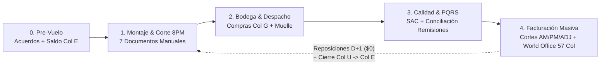

# Plan Maestro de Lanzamiento Operativo & Lista de Chequeo (48H)
**Operación Controlada E2E: Miércoles 11 Nov (Pedidos Jueves 12) y Jueves 12 Nov (Pedidos Viernes 13)**  
**Base Contractual:** `SPEC.md` — Capítulos 20.9, 26, 30 (*Circuito Cerrado de 4 Estaciones en Modo Manual*), 35 (*Calidad, SAC & RNC*) y 39 (*Facturación Masiva & World Office 57 Columnas*).

> [!IMPORTANT]
> **Regla de Oro de los Dos Ciclos Solapados:**  
> - **Ciclo 1 (Hoy Miércoles 11 ➔ Entrega Jueves 12):** Hoy hasta las **8:00 p.m.** se montan, auditan y sellan los pedidos que salen a ruta mañana jueves en la madrugada; mañana jueves en la mañana se reciben PQRS, se concilian remisiones firmadas y se ejecuta la carga masiva a facturación (World Office).  
> - **Ciclo 2 (Mañana Jueves 12 ➔ Entrega Viernes 13):** Mañana jueves, en paralelo al cierre de calidad y facturación del Ciclo 1, se montan los pedidos para entrega del viernes 13 (incluyendo pedidos reprogramados y reposiciones `$0 COP` originadas por SAC en la mañana del jueves).

---

## 1. Mapa de Control del Circuito Cerrado (4 Estaciones SDD Cap. 30)

---

## 2. Cronograma Táctico de Ejecución (Hoy Miércoles 11 y Mañana Jueves 12)

| Franja Horaria | Ciclo | Estación | Actividad Crítica & Módulo Responsable | Entregable / Estado de Salida |
| :--- | :---: | :--- | :--- | :--- |
| **Mié 11 · 1:00 p.m. – 3:00 p.m.** | Pre-Vuelo | Gobernanza Comercial & Bodega | Saneamiento de acuerdos vigentes, verificación de precios `> $0` y validación de saldo inicial `Col E` en Sábana de Inventario. | Acuerdos blindados + Base de neteo lista |
| **Mié 11 · 2:00 p.m. – 7:45 p.m.** | **Ciclo 1** | Estación 1: Montaje de Pedidos | Procesamiento de Bandeja Email (`Hoy`), WhatsApp/PDF/Excel y Portal B2B con entrega **Jueves 12/Nov** en `/admin/orders/loading` y `/admin/orders/create`. | 100% pedidos en `pending_approval` auditados |
| **Mié 11 · 7:45 p.m. – 8:15 p.m.** | **Ciclo 1** | Estación 1: Lanzamiento Modo Manual | Ejecución de `ManualDispatchWizardModal`: asignación de espacios `1–150`, impresión de **7 documentos físicos** y sello Poka-Yoke. | Pedidos en `para_compra` + 7 documentos impresos |
| **Mié 11 · 9:00 p.m. – Jue 12 · 4:30 a.m.** | **Ciclo 1** | Estación 2: Abastecimiento & Muelle | Compra en plaza, recepción a ciegas, ingesta en **Columna G**, picking por células, rectificación en muelle (`/ops/rectificacion`) y cargue LIFO. | Camiones en ruta con Remisiones Duplex + Rutero |
| **Jue 12 · 5:30 a.m. – 12:30 p.m.** | **Ciclo 1** | Estación 3: Recepción PQRS & Calidad | Atención en vivo de entregas, radicación y dictamen RCA en `/admin/customer-service` (SLA `< 2h`), cuarentena de retornos (`Col O` / `Col Q`) y reposiciones `D+1`. | Novedades liquidadas en `billing_returns` + Actas RNC |
| **Jue 12 · 11:00 a.m. – 3:30 p.m.** | **Ciclo 1** | Estación 4: Conciliación & Facturación Masiva | Conciliación de remisiones físicas en `/admin/orders/contingency-reconciliation`, liquidación de tarifas `$0`, generación de Cortes `AM / PM / ADJ` en `/admin/commercial/billing` y exportación **World Office (57 cols)**. | Facturas DIAN + Plano `.xlsx` 57 cols cargado |
| **Jue 12 · 2:00 p.m. – 5:00 p.m.** | **Ciclo 1** | Estación 2: Cierre Físico de Bodega | Conteo físico con los 6 folios en **Columna T**, conciliación de `Col V / Col W` y `Cerrar Turno` (`daily_inventory_closings`). | Saldo `Col U` congelado ➔ hereda a `Col E` del Ciclo 2 |
| **Jue 12 · 9:00 a.m. – 7:45 p.m.** | **Ciclo 2** | Estación 1: Montaje Entrega Viernes 13 | Montaje continuo de pedidos entrantes + pedidos reprogramados para el **13/Nov** + órdenes de reposición `$0 COP` de la mañana. | Tanda del Viernes 13 lista para corte 8:00 p.m. |
| **Jue 12 · 7:45 p.m. – 8:15 p.m.** | **Ciclo 2** | Estación 1: Lanzamiento Tanda Viernes 13 | Asignación de espacios `1–150`, neteo contra el nuevo cierre oficial `Col E`, emisión de las **7 piezas manuales** y sello a `para_compra`. | Operación Viernes 13 lanzada y bloqueada |

---

## 3. Lista de Chequeo Operativa (Checklist de Compuertas Poka-Yoke)

### BLOQUE 0 — Compuerta Pre-Vuelo (Hoy Miércoles antes de Cierre Comercial)
- [x] **0.1 Consistencia y Reconciliación de Acuerdos Comerciales (`/admin/commercial`):**
  - Reconciliación al 100% contra la carpeta Fuente de Verdad `ACUERDOS VIGENTES` (`SPG *.xlsx`).
  - Precios actualizados al centavo en base de datos (`quotes` y `quote_items`), tuplas duplicadas eliminadas y vigencias extendidas formalmente hasta el **30/nov/2026** (El Carnal, Aldimark, Colsubsidio, Peñalisa, San Jorge, Carnicolas, CESAP, CESNE, Termocity, Nutresa/Corral, Hotel Capital, San Gregorio, Tequendama Catering y Listas Quincenal/Mensual).
  - Exclusividad mutua activada: clientes con acuerdo individual desvinculados de listas masivas para evitar colisión de precios.
- [x] **0.2 Cero Precios en `$0` Involuntarios & Soberanía de `accounting_id` (Escenario 429):**
  - Prioridad 1 mandatoria para `#ID` contable en el motor de búsqueda (`order-parser-engine.ts`) con regex estricta anti-secuestro de kilos/cantidades.
  - En `/admin/orders/create`, el matcher prioriza restrictivamente los SKUs del convenio del cliente (`effectiveAgrIds`) evaluando nombre + observaciones (garantizando `#726 Mora Despitonada` sobre `#274 Mora`).
  - Poka-Yoke anti-tarifa cero en `/api/orders/resolve-agreement-pricing`: compras fuera de lista autorizadas (`allow_off_agreement_purchases = true`) liquidan automáticamente la tarifa vigente de **General Institucional** en vez de clavar `$0 COP`.
- [x] **0.3 Purga y Sanitización de Base de Datos para el Go-Live (Hito de Transición en Blanco):**
  - Se ejecutó la depuración forense en cascada de **1.079 pedidos legacy y pruebas de desarrollo** anteriores al ciclo de hoy (`sequence_id < 1538`).
  - La tabla `orders` y `order_items` quedó en estado prístino, conteniendo **exclusivamente los pedidos vivos montados hoy para entrega del Jueves 12/Nov**.
  - Cero interferencias en consolas, planillas de alistamiento y ruteo con pedidos residuales o históricos de meses previos.
- [ ] **0.4 Base Oficial de Inventario (`daily_inventory_closings`):** Confirmar que exista cierre oficial previo (`Columna U ➔ Columna E`) para que la ecuación `Compra Neta = max(0, Demanda + StockSeg - Inventario Base)` no parta de saldos flotantes.
- [ ] **0.5 Hora de Corte y Consecutivos DIAN (`/admin/settings`):** Validar `cutoff_hour_admin` (`20:00`), prefijo `billing_invoice_prefix`, número de resolución `billing_resolution_number` y vigencia DIAN activa.

---

### BLOQUE 1 — Montaje y Auditoría de Pedidos (Hoy Miércoles ➔ Entrega Jueves 12/Nov)
- [ ] **1.1 Vaciado de Bandeja de Entrada Email (`/admin/orders/loading` pestaña Bandeja Email):**
  - Revisar el contador `Hoy` (inmutable por fecha de llegada `created_at`) y la píldora centinela `+N en Otras Fechas`.
  - Verificar correos con múltiples adjuntos Excel (ej. múltiples OC en un mismo hilo como Colsubsidio) para aprobar cada OC legítima sin confundirla con duplicado.
  - Si un correo recibido hoy pide entrega para otro día (ej. viernes 13 o martes 17), asignar su `deliveryDate` real y aprobarlo para que pase limpio a la fecha objetivo.
- [ ] **1.2 Montaje Manual, WhatsApp, PDF/Excel y Portal B2B (`/admin/orders/create`):**
  - Confirmar siempre **Sucursal de entrega** (jamás consignar pedidos a la Casa Matriz, Cap. 1 SDD).
  - Validar unidades normalizadas (`Kg = 1.0 kg`, `Lb = 0.5 kg`, `Unidad` por defecto cuando no trae unidad).
  - Verificar especificaciones físicas de alistamiento vs variantes de producto para evitar partidas erróneas.
- [ ] **1.3 Barrido de Calidad Pre-Corte en Consola de Pedidos del Día (`/admin/orders/loading` filtrando entrega `2026-11-12`):**
  - Ejecutar comando `@sin_gps` en el superbuscador ➔ debe dar **0 pedidos sin coordenadas**.
  - Ejecutar comando `@duplicados` ➔ validar o descartar cualquier posible orden repetida por OC/SOLPED/ítems.
  - Revisar que ningún pedido comercial tenga valor `$0 COP` salvo **Remisiones de Obsequio** autorizadas (`gift_remission`) o ítems expresamente aprobados de consumo abierto.

---

### BLOQUE 2 — Generación de Documentos en Modo Manual y Sello de Tanda (8:00 p.m.)
Abrir el asistente de lanzamiento en Modo Manual (`ManualDispatchWizardModal`) sobre la tanda del **Jueves 12/Nov**:

- [ ] **2.1 Paso 1 — Asignación de Espacios Físicos (`1 a 150`):**
  - Pulsar `[Auto-Asignar (LIFO + Clúster)]` y verificar que ningún pedido quede sin espacio (`warehouse_spaces` poblado; prohibido caer en `sequence_id`, Escenario 285).
  - Avanzar con `Continuar a Compras & Recibo ->` para persistir atómicamente los espacios en BD.
- [ ] **2.2 Emisión y Verificación Física de la Batería de 7 Documentos Oficiales (Cap. 30.2.3):**
  - [ ] **Doc 1 — Sábana de Alistamiento por Células** (`/admin/orders/alistamiento-print` — *Oficio Horizontal*): revisar legibilidad zebra striping y orden secuencial de espacios.
  - [ ] **Doc 2 — Planillas de Compras de Plaza por Sublista** (`/admin/procurement/purchases-print` — *Carta*: Papa, Frutas, Plátano, Hortalizas) + descarga de respaldo `compras_2026-11-12.xlsx` (11 columnas).
  - [ ] **Doc 3 — Control de Llegada / Entrada a Almacén** (`/admin/procurement/receiving-print` — *Carta 2 columnas A-Z* para báscula a ciegas).
  - [ ] **Doc 4 — Planilla de Conteo Físico de Bodega** (`/admin/inventory/physical-count-print` — *6 Folios Carta* por familias para cierre de turno).
  - [ ] **Doc 5 — Juegos de Remisión Duplicadas** (`/admin/orders/contingency-print?mode=remissions` — *Carta Duplex*):
    - Verificar `ORIGINAL - CLIENTE` + `COPIA - ARCHIVO Y CONTABILIDAD`.
    - Confirmar respeto a `remission_with_prices` (a ciegas vs valorizada), membrete *Investments Cortés S.A.S.*, espacio físico impreso, recuadro de canastillas y **Código QR dinámico de PQR** legible.
  - [ ] **Doc 6 — Manifiesto de Despacho / El Rutero** (`/admin/orders/contingency-print?mode=dispatch` — *Carta*): revisar vehículo, conductor, paradas LIFO, peso total y casillas de canastillas entregadas/devueltas.
  - [ ] **Doc 7 — Etiquetas Térmicas 100×50mm** (`/admin/orders/print-labels`): imprimir rollo Zebra/Xprinter exclusivamente para SKUs procesados/empacados con `requires_label = true` (`#ID` contable + lote + vencimiento + cliente).
- [ ] **2.3 Excepción Clientes `factura_pre_despacho`:** Si en la tanda viaja alguna cadena que exija factura física en muelle antes de descargar, emitir su factura previa en `/admin/commercial/billing`.
- [ ] **2.4 Sello Poka-Yoke de Tanda:** Marcar el check de verificación física (`step4Confirmed`) y pulsar `FINALIZAR Y ENVIAR A PROCESO LOGÍSTICO` ➔ confirmar que el 100% de pedidos pasen a `status = 'para_compra'` (bloqueados en solo lectura).

> [!WARNING]
> **Pedidos Extemporáneos Post-8:00 p.m.:** Prohibido reabrir o reimprimir la tanda principal sellada. Todo pedido de emergencia posterior al corte se tramita únicamente como **«Venta Adicional»** (impactando **Columna M** de la Sábana de Inventarios).

---

### BLOQUE 3 — Ejecución de Madrugada, Rectificación y Salida a Reparto (Jueves 12/Nov)
- [ ] **3.1 Ingesta de Entradas de Plaza en Columna G (`/admin/inventory`):** Transcribir kilos reales comprados y costos usando Modal Rápido por teclado (`Tab/Enter`), fórmula en celda o importación Excel.
- [ ] **3.2 Compuerta Shift-Left de Rectificación en Muelle (`/ops/rectificacion` — Cap. 26):**
  - Antes de cerrar puertas del furgón, verificar faltantes o averías detectadas al cargar.
  - Si un ítem se ajusta en muelle, **regenerar y reimprimir en caliente la remisión física** del cliente afectado para que viaje con cantidades 100% reales (Factura Neta Cero-Discrepancias).
- [ ] **3.3 Control de Flota y Telemetría (`/admin/transport`):** Confirmar conductor asignado, odómetro de salida y señal GPS activa (satelital M2M o Baliza Móvil PWA en celulares de flota alquilada).

---

### BLOQUE 4 — Recepción de PQRS en Gestión de Calidad & Conciliación de Remisiones (Jueves 12/Nov Mañana)
- [ ] **4.1 Monitoreo Activo de los 3 Canales de Entrada de PQRS (Cap. 20.9 & Cap. 35):**
  - Escaneo de QR desde la Remisión Física (`/pqrs`), Autogestión en `/b2b/dashboard` y línea asistida WhatsApp SAC / PBX.
  - Vigilar barra SLA de **2 horas (120 min)** en `/admin/customer-service` (Escenario 321).
- [ ] **4.2 Liquidación en el Wizard de 3 Pasos (`/admin/customer-service` — `PqrAuditModal`):**
  - **Paso 1 (Contexto & Evidencia):** Adjuntar evidencia fotográfica y verificar que la PQR esté vinculada a la **Sucursal exacta** (jamás a Casa Matriz, Escenario 278). Marcar correctamente el flag `has_physical_return` (`true` si vuelve mercancía en el camión; `false` si fue faltante o desecho en sitio).
  - **Paso 2 (Diagnóstico RCA & Imputabilidad):** Clasificar macrocausa L1/L2 y asignar % de responsabilidad nominal (Transporte, Bodega/Picking, o Proveedor de Campo para cobro en `/admin/procurement` Escenario 255/256). Emitir **Acta Legal RNC** en `/admin/customer-service/rnc/[id]/print` cuando aplique deducción o reclamo a proveedor.
  - **Paso 3 (Resolución Comercial Sin Fricción):**
    - **Opción 1 — Sustracción Neta / Ajuste previo a factura:** Para clientes `remision_post_entrega` dentro de ventana antes del corte; descuenta de `billing_returns` / `order_items` para que la factura nazca exacta sin Nota Crédito.
    - **Opción 2 — Orden de Reposición Física `D+1` (`$0 COP`):** Genera automáticamente el pedido hijo con linaje Padre ↔ Hijo para la tanda del **Viernes 13/Nov** (bloqueando ping-pong si ya era reposición, Escenario 147).
    - **Opción 3 — Nota Crédito Comercial World Office:** Cuando la factura ya fue emitida o por política del cliente; enciende el **Badge Neón Púrpura** obligatorio en Facturación (Escenario 257).
- [ ] **4.3 Cuarentena de Patio para Retornos Físicos (`has_physical_return = true`):**
  - Inspeccionar físicamente los productos que regresen en los furgones antes de tocar inventario:
    - Producto inocuo y apto ➔ asentar en **Columna O** (*Reingreso vendible*).
    - Producto con daño/avería ➔ asentar en **Columna Q** (*Baja por avería*), y mermas naturales en **Columna R**.
- [ ] **4.4 Mesa de Conciliación de Remisiones Físicas Firmadas (`/admin/orders/contingency-reconciliation` — Cap. 39.5):**
  - Con los desprendibles firmados y sellados en mano:
    - Remisiones limpias sin tachones ➔ pulsar `[Aprobar 100% Exacto (Sin Novedad)]` + registrar canastillas entregadas vs recuperadas.
    - Remisiones con diferencia en báscula del cliente (que aún no tenían PQR digital) ➔ digitar cantidad recibida real, elegir causal y pulsar `[Guardar y Generar Ajuste]` para inyectar el descuento aprobado en `billing_returns`.
  - Archivar físicamente las copias firmadas en orden correlativo como soporte DIAN.

---

### BLOQUE 5 — Carga Masiva a Facturación, Cortes y Exportación World Office (Jueves 12/Nov Tarde)
- [ ] **5.1 Auditoría de Cola en `/admin/customer-service/novedades` y Ventana de Gracia:**
  - Confirmar que hayan transcurrido los **120 minutos de gracia** post-entrega (o que la remisión ya esté conciliada en firme) y que no queden PQRS en estado `Pendiente` / `En Auditoría` para los pedidos a facturar.
- [ ] **5.2 Compuerta Poka-Yoke Anti-Tarifa `$0` en `/admin/commercial/billing` (Cap. 39.2):**
  - Abrir previsualización del **Corte AM / PM**.
  - Si aparece alerta roja de pedidos o líneas en `$0 COP` / `CONSUMO ABIERTO` (no obsequios), asignarle tarifa comercial o ejecutar el botón de doble confirmación `[Liquidar Costo Vigente]` antes de emitir el corte.
- [ ] **5.3 Emisión del Corte Oficial de Facturación (`AM` / `PM`) y Golden Print:**
  - Confirmar el corte ➔ verificar creación de `billing_cuts` y consecutivos correlativos en `billing_invoices`.
  - Abrir `/admin/commercial/billing/print/[id]` y emitir/exportar los PDFs oficiales con resolución DIAN.
- [ ] **5.4 Emisión del Corte de Ajustes (`ADJ`) y Gestión de Alertas Púrpura (Camino 3):**
  - Procesar todas las devoluciones/notas crédito pendientes en un **Corte `ADJ`** (`NC`).
  - Revisar que ningún pedido quede con el **Badge Neón Púrpura** de Nota Crédito World Office sin radicar (Escenario 257).
- [ ] **5.5 Generación y Validación del Plano de Carga Masiva a World Office Desktop (57 Columnas — Escenarios 182, 272, 273, 280, 302, 360, 369):**
  - Descargar el archivo `.xlsx` de migración contable desde el corte generado en `/admin/commercial/billing` (y para gastos/compras de contado el plano de 50 columnas en `/admin/procurement` si aplica cierre de caja de plaza).
  - **Checklist de Integridad del Excel antes de importar en World Office Desktop:**
    - [ ] **Tipo de Documento:** `FV` para Facturas de Venta y `NC` para Notas Crédito.
    - [ ] **Columna D (Consecutivo):** Numérico puro sin letras ni prefijos pegados al número (Escenario 273).
    - [ ] **Tercero Fiscal:** NIT de la persona jurídica matriz limpio, sin dígito de verificación ni guiones; nombre de sucursal limpio y desacoplado en su columna correspondiente (Escenario 272).
    - [ ] **Identificador de Producto:** Prevalencia estricta del Código Contable `#ID` (`accounting_id`) activo en World Office y unidad de facturación (`KG` / `LB` según parámetro del cliente, Escenario 254).
    - [ ] **Impuestos y Totales:** Tasas de IVA (`0%` agrícola Art. 424 E.T. vs `5%` / `19%` procesados) cuadradas al centavo contra el total neto post-novedades.
  - Ejecutar importación en World Office Desktop y confirmar **0 errores de validación**.

---

### BLOQUE 6 — Cierre de Bodega Día 1 + Empalme con Lanzamiento del Ciclo 2 (Jueves 12/Nov ➔ Entrega Viernes 13/Nov)
- [ ] **6.1 Cierre de Inventario Físico Jueves Tarde (`/admin/inventory` — Cap. 30.3.2):**
  - Digitar los **6 Folios Carta** del conteo físico de piso en la **Columna T**.
  - Justificar cualquier variación fuera de tolerancia en Faltantes (**Col V**) o Sobrantes (**Col W**).
  - Pulsar **`Cerrar Turno`** para congelar `daily_inventory_closings` (`Col U = Col T + Col O`), dejando lista la **Columna E** exacta para el neteo de la noche del jueves.
- [ ] **6.2 Montaje y Auditoría de la Tanda del Viernes 13/Nov (Jueves hasta las 7:45 p.m.):**
  - Verificar que en `/admin/orders/loading` (fecha entrega `2026-11-13`) estén incluidos:
    1. Todos los pedidos nuevos entrados el jueves por Email, WhatsApp, PDF/Excel y Portal B2B.
    2. Los pedidos recibidos en días previos con entrega programada para el **13/Nov** (ej. *Hotel Peñalisa* / colegios reprogramados).
    3. Todas las **Órdenes de Reposición `D+1` (`$0 COP`)** generadas por Calidad/SAC durante la mañana del jueves.
  - Repetir barrido `@sin_gps = 0`, `@duplicados = 0` y cero precios `$0` involuntarios.
- [ ] **6.3 Corte 8:00 p.m. del Jueves 12/Nov:** Ejecutar nuevamente el **Bloque 2 completo** (Espacios `1–150` + **7 Documentos Manuales** + Sello a `para_compra`) para el despacho de madrugada del **Viernes 13/Nov**, y el viernes en la mañana cerrar el ciclo con **Bloques 4 y 5** (PQRS + Carga Masiva Facturación Viernes).
