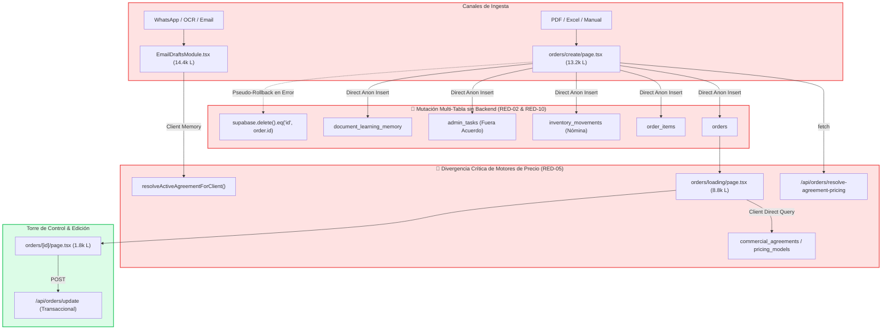
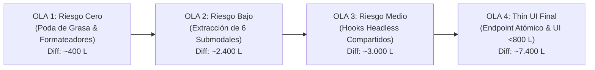

# 🗺️ Atlas Integral del Sistema & Matriz de Estrellas Rojas (Lean VSM)
## Plataforma: onFRU / FruFresco — SCOS (Supply Chain Operating System)
## Marco Contractual: Auditado contra SPEC.md (Contrato Normativo Canónico) & TECHNICAL_DEBT.md
## Fecha de Emisión: 2026-11-10T10:25:00-05:00 | Cobertura: 100% de los bytes inspeccionados en Mega-Módulo de Pedidos

> **Vínculo Constitucional con el SDD:**  
> Este Atlas no redefine el alcance ni prescribe nuevas reglas de negocio. Su función es levantar la radiografía física del 100% de los bytes en disco y auditar el código vivo contra los escenarios estipulados en el [`SPEC.md`](./SPEC.md). Toda discrepancia donde el código no cumpla el contrato o presente cables pelados se etiqueta como **Estrella Roja (Red Tag)** hasta su erradicación.

---

### 1. 📊 Macro-Diagrama de Valor E2E del Mega-Módulo de Pedidos (VSM Gemba)

---

### 2. 🧭 Anatomía y Desglose Modular de `src/app/admin/orders/create/page.tsx` (13.264 L)

El análisis forense identifica 5 clusters masivos que hoy conviven en un solo archivo:

| Componente Oculto / Dominio | Rango de Líneas | Peso Físico | Descripción & Acoplamiento |
| :--- | :---: | :---: | :--- |
| **Utilidades y Formateadores Puros** | L1 – L271 | 271 L (2.0%) | Matemáticas puras (`evaluateMathExpression`, `getParsedWeight`, `normalizeDocUnit`). |
| **Estado Global Monolítico (125 `useState`)** | L272 – L1.268 | 997 L (7.5%) | 11 clusters de estado (pricing, clientes, logística, staging, multi-entrega). |
| **Lógica Transaccional & 75 Handlers** | L1.269 – L5.738 | 4.470 L (33.7%) | Handlers directos de mutación de base de datos, geolocalización e ingesta IA. |
| **Mesa de Trabajo JSX Principal** | L5.739 – L10.689 | 4.951 L (37.3%) | Layout, buscador de clientes B2B/B2C, canasta y tabla de totales. |
| **6 Submodales Embebidos en Línea** | L10.690 – L13.251 | 2.562 L (19.3%) | Modales de variantes, conversiones, mapa Google, PIP visor y multi-orden. |

---

### 3. 🚨 Tablero de Control de Estrellas Rojas (Lean Red Tag Board)

| Tag ID | Dominio | Pipeline | Archivo & Línea | Tipo | Evidencia en Código Vivo | Impacto Gemba / Planta | Nivel Prioridad | Estado |
| :---: | :---: | :---: | :--- | :---: | :--- | :--- | :---: | :---: |
| **RED-01** | D04 (Pedidos) | P2 | `orders/create/page.tsx:272` | Tipo E | Ausencia total de `useAuth()` | Cualquier sesión accede a 16 tablas sin RBAC | 🔴 P1 - Bloqueante | Pendiente |
| **RED-02** | D04 (Pedidos) | P2 | `orders/create/page.tsx:5207` | Tipo D | `if (itemsError) await supabase.from('orders').delete()` | Pedidos huérfanos con $0 si falla la conexión en muelle | 🔴 P1 - Bloqueante | Pendiente |
| **RED-03** | D04 (Pedidos) | P2 | `orders/create/page.tsx:5257` | Tipo D | `handleSubmit` manual nunca envía correo | Pedidos manuales quedan sin notificación oficial al cliente | 🟠 P2 - Crítica | Pendiente |
| **RED-04** | D04 (Pedidos) | P2 | `orders/create/page.tsx:4604` | Tipo D | Falla atómica en multi-entrega | Si la orden 2 falla, la orden 1 se duplica al reintentar | 🔴 P1 - Bloqueante | Pendiente |
| **RED-05** | D03 (Pricing) | P1 | `create:1361` vs `drafts:3517` | Tipo B | 3 algoritmos de precios distintos | Discrepancia de precios entre cotización, correo y alistamiento | 🔴 P1 - Bloqueante | Pendiente |
| **RED-06** | D04 (Pedidos) | P2 | `orders/create/page.tsx:3796` | Tipo A | 6 llamados a `window.confirm()` | Congela el hilo UI y bloquea PWA táctiles en bodega | 🟡 P3 - Higiene | Pendiente |
| **RED-07** | D04 (Pedidos) | P2 | `orders/create/page.tsx:3185` | Tipo A | Token hunting manual en `localStorage` | Inestabilidad en la extracción IA de pedidos | 🟡 P3 - Higiene | Pendiente |
| **RED-08** | D04 (Pedidos) | P2 | `orders/create/page.tsx:4079` | Tipo A | Declaración doble de `formatT` | Código redundante producto de copy-paste masivo | 🟡 P3 - Higiene | Pendiente |
| **RED-09** | D06 (Logística) | P4 | `create:3993` vs `drafts:358` | Tipo C | Cálculo divergente de Kilos | Discrepancia en peso total de despacho y flete | 🟠 P2 - Crítica | Pendiente |
| **RED-10** | D04 (Pedidos) | P2 | `orders/create/page.tsx:5212` | Tipo E | Browser escribe en `inventory_movements` | Vulnerabilidad de manipulación de inventarios desde el cliente | 🔴 P1 - Bloqueante | Pendiente |

---

### 4. 🎯 Plan Táctico de Erradicación & Lista de Chequeo No Destructiva (Burndown Checklist)

#### 🟢 OLA 1: Riesgo Cero (Poda de Grasa & Formateadores Puros)
- [ ] **Paso 1.1:** Extraer constantes (`THEME`, estilos inline, IDs canónicos) a `src/lib/orders/orderConstants.ts`.
- [ ] **Paso 1.2:** Extraer funciones utilitarias puras (`normalizeDocUnit`, `getAccountingIdDisplay`, `formatWeightKg`, `evaluateMathExpression`) a `src/lib/orders/orderFormatters.ts`.
- [ ] **Paso 1.3:** Erradicar la doble declaración de `formatT` (L4079 y L4984).
- [ ] **Paso 1.4:** Reemplazar los 6 `window.confirm()` por diálogos no bloqueantes (`ConfirmModal`).
*Criterio de Aprobación:* `npx.cmd tsc --noEmit` arroja 0 errores; paridad en `localhost:3001`.

#### 🟡 OLA 2: Riesgo Bajo (Extracción de Submodales Autónomos)
- [ ] **Paso 2.1:** Extraer Submodal 5 (Visor Flotante) a `src/components/admin/orders/FloatingDocumentViewerModal.tsx` (~195 L).
- [ ] **Paso 2.2:** Extraer Submodal 2 (Conversiones y Empaques Alt+E) a `src/components/admin/orders/PackagingConversionsModal.tsx` (~240 L).
- [ ] **Paso 2.3:** Extraer Submodal 3 (Variantes Alt+V) a `src/components/admin/orders/ProductVariantsConfigModal.tsx` (~28 L).
- [ ] **Paso 2.4:** Extraer Submodal 4 (Google Maps & Polígono) a `src/components/admin/orders/GoogleMapsPickerModal.tsx` (~660 L).
- [ ] **Paso 2.5:** Extraer Submodal 6 (División Multi-Entrega) a `src/components/admin/orders/MultiOrderSplitModal.tsx` (~293 L).
- [ ] **Paso 2.6:** Extraer Submodal 1 (Configuración de Producto) a `src/components/admin/orders/ProductConfigModal.tsx` (~1.005 L).
*Criterio de Aprobación:* `create/page.tsx` reduce ~2.400 líneas; atajos de teclado intactos.

#### 🟠 OLA 3: Riesgo Medio (Extracción de Hooks Headless Compartidos)
- [ ] **Paso 3.1:** Crear `src/hooks/orders/useOrderPricingResolver.ts`: Unifica `resolveContract`, matrices de acuerdos, campañas y permisos fuera de convenio (elimina RED-05).
- [ ] **Paso 3.2:** Crear `src/hooks/orders/useDeliverySchedule.ts`: Encapsula festivos, reglas de corte, horarios manuales y restricciones de día.
- [ ] **Paso 3.3:** Crear `src/hooks/orders/useGeolocationGeofence.ts`: Encapsula geocodificación, lat/lng y validación de cobertura.
- [ ] **Paso 3.4:** Crear `src/hooks/orders/useOrderCart.ts`: Encapsula gestión del carrito, descuentos de colaboradores, totales y deduplicación.
- [ ] **Paso 3.5:** Crear `src/hooks/orders/useStagedOrderAudit.ts`: Encapsula la mesa de auditoría de documentos, ingesta por IA y asignación rápida.
*Criterio de Aprobación:* 125 useStates consolidados en 5 hooks canónicos estructurados.

#### 🔴 OLA 4: Cierre Hermético Thin UI & Endpoint Transaccional Atómico
- [ ] **Paso 4.1:** Inyectar `useAuth()` y validación RBAC en el montaje de la página (elimina RED-01).
- [ ] **Paso 4.2:** Construir endpoint backend atómico `POST /api/orders/create` (o función RPC transaccional en PostgreSQL) con transacción real `BEGIN ... COMMIT` (elimina RED-02, RED-03, RED-04 y RED-10).
- [ ] **Paso 4.3:** Reducir `src/app/admin/orders/create/page.tsx` a un orquestador Thin UI limpio de **< 800 líneas**.
*Criterio de Aprobación:* Cero escrituras directas en Supabase desde el cliente; 0 errores de compilación TypeScript.

---

### 4.1 Matriz de Recursos Candidatos a Unificación Transversal (Eliminación de 4.600 Líneas Duplicadas)

La radiografía forense E2E revela que el mega-módulo de pedidos (`orders/create`) comparte 6 componentes y motores de cálculo idénticos con `EmailDraftsModule`, `orders/loading` y `orders/[id]`. La unificación de estos 6 recursos eliminará más de 4.600 líneas de código redundante:

| Recurso Candidato | Propósito Operativo | Módulos Donde Existe Hoy | Ubicación Actual en Código | Destino Canónico Canónico | Potencial de Reducción |
| :--- | :--- | :--- | :--- | :--- | :---: |
| **`ProductVariantCustomizerModal`** | Selección de opciones, tríada de preferencias cliente y mín. venta. | `create`, `drafts`, `loading`, `[id]` | `create:10689-11693` `drafts:12000-12919` `loading:6786-7315` `[id]:1742-1825` | `src/components/admin/orders/ProductVariantCustomizerModal.tsx` | **~2.200 LOC** |
| **`ProductConversionsModal`** | CRUD en caliente de factores de conversión y empaques (Alt+E). | `create`, `drafts`, `loading` | `create:11694-11961` `drafts:12920-13180` `loading:6688-6720` | `src/components/admin/orders/ProductConversionsModal.tsx` | **~550 LOC** |
| **`evaluateMathExpression`** | Parsing aritmético seguro (`"3+2"`, comas/puntos) sin eval. | `create`, `drafts`, `staging` | `create:281` `drafts:271` `PhysicalSheet:55` | `src/lib/orders/orderFormatters.ts` | **~90 LOC** |
| **`useDeliveryScheduleRules`** | Festivos, restricciones cliente, hora de corte y multi-entrega. | `create`, `drafts`, `loading` | `create:2939, 10159` `drafts:370, 1200` `loading:1150` | `src/hooks/orders/useDeliveryScheduleRules.ts` | **~580 LOC** |
| **`useOrderPricingResolver`** | Motor único de precios B2B/B2C/Campañas (Erradica `RED-05`). | `create`, `drafts`, `loading` | `create:1361, 2000` `drafts:3465, 4130` `loading:1348` | `src/hooks/orders/useOrderPricingResolver.ts` | **~750 LOC** |
| **`FloatingDocumentViewerModal`** | Visor flotante PIP de PDF/Imágenes con barra de resumen sticky. | `create`, `drafts`, `loading` | `create:12674-12869` `drafts:5800-5980` `loading:8100` | `src/components/admin/orders/FloatingDocumentViewerModal.tsx` | **~450 LOC** |
| **TOTAL CONSOLIDADO** | **6 Refacciones Unificadas Transversales** | **4 Módulos Core** | **Coexistencia de 5.223 Líneas** | **Arsenal Modular Canónico** | **~4.620 LOC Netas** |

#### Checklist Secuencial No Destructivo para la Ventana de Mantenimiento Posterior:
- [ ] **Paso U1 (Utilidades Matemáticas Puras):** Extraer `evaluateMathExpression` a `src/lib/orders/orderFormatters.ts` y sustituir las 14 instancias locales en `orders/create`, `EmailDraftsModule` y `PhysicalSheetStagingTable`.
- [ ] **Paso U2 (Modal de Conversiones Alt+E):** Extraer `ProductConversionsModal.tsx` a `src/components/admin/orders/`, consumiéndolo desde `orders/create` y `EmailDraftsModule`.
- [ ] **Paso U3 (Visor PIP de Documentos):** Extraer `FloatingDocumentViewerModal.tsx` desacoplando `PdfCanvasViewer` y la barra de resumen inferior sticky.
- [ ] **Paso U4 (Hook de Reglas de Entrega):** Construir `useDeliveryScheduleRules.ts` unificando el cálculo de festivos y multi-entregas entre creación manual y borradores.
- [ ] **Paso U5 (Hook de Resolución de Precios):** Consolidar `useOrderPricingResolver.ts`, erradicando definitivamente la Estrella Roja `RED-05`.
- [ ] **Paso U6 (Modal Personalizador de Variantes):** Extraer `ProductVariantCustomizerModal.tsx`, reemplazando los 4 modales anónimos embebidos en `create`, `drafts`, `loading` y `[id]`.
- [ ] **Paso U7 (Auditoría Forense Final):** Ejecución de `npx.cmd tsc --noEmit` y prueba de regresión visual en `localhost:3001` sin errores.

---

---

### 5. 🏁 Veredicto de Certificación para Producción
- **Índice de Madurez E2E del Módulo:** **28% (Alerta Roja Arquitectónica)**
- **Total Estrellas Rojas Detectadas:** **10** (Bloqueantes P1: **5**, Críticas P2: **2**, Higiene P3: **3**)
- **Veredicto Operativo:** **APROBADO PARA SALIDA EN VIVO HOY EN MODO CODE-FREEZE.** La aplicación funciona gracias a los parches acumulados, pero requiere ejecutar el Burndown Plan de la Ola 1 a la Ola 4 en la próxima ventana de mantenimiento para garantizar estabilidad y mantenibilidad futura.
